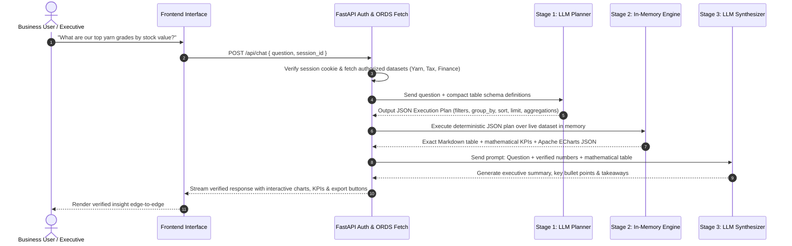

# Enterprise AI Hub — System Architecture & Agent Technical Documentation
**Version:** 2.4.0-PRO  
**Author:** Enterprise AI Engineering Team  
**Platform:** Oracle Cloud Infrastructure Autonomous Database (ORDS) + FastAPI + Modern Web Client  

---

## 1. Overview & Core Mission
**Enterprise AI Hub** is an enterprise-grade Autonomous Data Intelligence Agent. It enables authorized executives, analysts, and business users to interact with live corporate databases through natural language, voice queries, verified aggregations, interactive charts, and multi-format document generation.

Unlike conventional chatbots that hallucinate numbers or execute dangerous arbitrary SQL queries directly against production databases, Enterprise AI Hub uses an **isolated dual-model planner/synthesizer architecture** paired with an **in-memory deterministic query sandbox**.

---

## 2. High-Level System Architecture

```mermaid
graph TD
    Client[Web & Mobile Client / Browser]
    
    subgraph FastAPI Application Server
        Auth[RBAC & Session Guard<br/>HMAC-SHA256 Cookie]
        FastPath[Fast-Path Export Router]
        LLM_Planner[LLM Planner<br/>Groq / Llama 3.3 70B]
        QueryEngine[In-Memory Query Engine<br/>Deterministic Math Sandbox]
        LLM_Synthesizer[LLM Synthesizer<br/>Executive Takeaways & Insights]
        ExportEngine[Multi-Format Export Engine<br/>PDF, Excel, Word, PPT]
    end
    
    subgraph Oracle Cloud Infrastructure
        ORDS[Oracle REST Data Services / ORDS]
        AutonomousDB[(Oracle Autonomous Database<br/>HR, Products, Yarn, Tax, Finance)]
        OAuth[OAuth 2.0 Security Layer]
    end

    Client <-->|HTTPS / TLS 1.3| Auth
    Auth --> FastPath
    Auth --> LLM_Planner
    LLM_Planner --> QueryEngine
    QueryEngine --> LLM_Synthesizer
    LLM_Synthesizer --> Client
    FastPath --> ExportEngine
    ExportEngine --> Client
    
    FastAPI Application Server <-->|Encrypted REST| ORDS
    ORDS <--> AutonomousDB
    ORDS <--> OAuth
```

---

## 3. The AI Agent Pipeline (Planner → Query Engine → Synthesizer)

The core agent intelligence operates in three decoupled stages:



### Stage 1: The Planner (Semantic Translation)
- **Role:** Understands intent and translates business language into a structured JSON query plan.
- **Input:** User prompt + available table names + column schemas.
- **Output:** Validated JSON plan containing:
  ```json
  {
    "table": "YARN_INVENTORY",
    "filter": [["STATUS", "==", "IN_STOCK"]],
    "group_by": ["GRADE"],
    "aggregates": [
      {"op": "sum", "col": "TOTAL_VALUE", "as": "STOCK_VALUE"},
      {"op": "sum", "col": "QUANTITY_KG", "as": "TOTAL_KG"}
    ],
    "sort": [{"col": "STOCK_VALUE", "dir": "desc"}],
    "limit": 5,
    "chart": {
      "type": "bar",
      "x": "GRADE",
      "y": ["STOCK_VALUE"],
      "title": "Top Yarn Grades by Stock Value"
    }
  }
  ```

### Stage 2: The In-Memory Query Engine (Deterministic Math)
- **Location:** [`query_engine.py`](file:///f:/AI/AI%204/query_engine.py)
- **Guarantee:** 0% hallucination. Operates strictly in Python memory using verified arithmetic.
- **Operations:**
  - Filtering (`==`, `!=`, `>`, `<`, `in`, `contains`, `between`, `is_null`)
  - Aggregations (`sum`, `avg`, `count`, `count_distinct`, `min`, `max`)
  - Grouping and pivoting
  - Multi-column sorting and top-N limits
  - Automatic currency cleaning (`$`, `PKR`, `Rs.`, `,`) and ISO date parsing
- **No Arbitrary Code:** Absolutely zero `eval()`, `exec()`, or raw dynamic SQL strings.

### Stage 3: The Synthesizer (Executive Presentation)
- **Prompt:** [`SYNTHESIZER_SYSTEM_PROMPT`](file:///f:/AI/AI%204/ui_app.py)
- **Rules:**
  1. **Executive Takeaway:** Starts with 1–2 crisp sentences highlighting the key trend or top contributor.
  2. **Math Truth:** Must use exact figures from Stage 2. Modifying or inventing numbers is prohibited.
  3. **Visual Charts:** Formats Apache ECharts JSON configs for rich visual rendering.
  4. **Dynamic Export Tags:** Embeds `[[EXPORT:pdf]]`, `[[EXPORT:xlsx]]` tags for 1-click downloads.

---

## 4. Multi-Tenant Role-Based Access Control (RBAC)

The system enforces strict multi-tenant boundaries between **Administrators** (`Nexus`, `Admin`) and **Regular Users**:

| Capability | Administrator (`Nexus` / `Admin`) | Regular Business User |
| :--- | :---: | :---: |
| **Chat & Conversational Analysis** | ✅ Full Access | ✅ Full Access (Authorized Tables Only) |
| **Interactive ECharts & Visuals** | ✅ Full Access | ✅ Full Access |
| **PDF, Excel, Word & PPT Exports** | ✅ Full Access | ✅ Full Access |
| **Table List in Explorer / Studio** | ✅ Full Table Details & Schemas | ✅ Authorized Table Names Only |
| **Live Database Grid Inspection** | ✅ Live Studio & Record Browser | ⛔ Restricted (403 Forbidden) |
| **Raw Column & Schema Inspector** | ✅ Column Data Types & Samples | ⛔ Restricted (Hidden) |
| **ORDS Endpoint Configuration** | ✅ Admin Management | ⛔ Read-Only Queries Only |
| **Usage Metering & Token Logs** | ✅ Full Cross-Tenant Logs | ⛔ Personal Usage Only |

---

## 5. Dynamic Table Adaptation (Yarn, Tax, Finance, Employees, Products)

The agent automatically adapts to whatever tables are granted to the user in Oracle APEX:
1. **Dynamic Schema Discovery:** Queries `GET /user-endpoints/{user_id}` on session startup.
2. **Active / Inactive Status Check:** Filters out any tables where `is_active == 'N'`, `status == 'INACTIVE'`, or `access_active == 'N'`. Access is disabled without needing to delete endpoints.
3. **Adaptive Prompt Suggestions:** The New Chat greeting pills inspect `cachedTables`:
   - `YARN` tables generate Yarn inventory and stock breakdown prompts.
   - `TAX` tables generate tax calculation and filing summary prompts.
   - `FINANCE` / `ACCOUNTING` tables generate finance balance and ledger prompts.
   - `EMPLOYEES` / `PRODUCTS` generate headcount and catalog comparison prompts.
   - Cross-table comparisons are generated whenever two or more tables exist.

---

## 6. Document Generation & File Export Engine

The agent generates fully formatted enterprise documents entirely in memory:
- **PDF Engine ([ReportLab](https://www.reportlab.com/)):**
  - Custom branded headers with Dream company logo and generation timestamp.
  - Page numbers, dynamic table column distribution, and word wrapping.
  - Unicode font support via embedded TrueType font (`Amiri-Regular.ttf`) for international characters.
  - Clean separation: divider lines are contextualized based on document headers.
- **Excel Engine ([OpenPyXL](https://openpyxl.readthedocs.io/)):**
  - Formatted data tables with bold headers, alternating row striping, auto-fitted column widths, and proper numeric cell formatting.
- **Word Engine ([python-docx](https://python-docx.readthedocs.io/)):**
  - Formal executive report layout with heading hierarchies and structured tables.
- **PowerPoint Engine ([python-pptx](https://python-pptx.readthedocs.io/)):**
  - Slide deck generation with title cards, KPI highlights, and data tables.

---

## 7. Zero Local Storage & Security Guarantees

1. **Zero Disk Storage:** No SQLite databases, local JSON files, or user session logs are written to the local web server filesystem. All persistent data lives securely inside the Oracle Cloud Autonomous Database.
2. **Secure Session Authentication:**
   - Stateless signed session cookies: `HMAC-SHA256` signed using `APP_SECRET`.
   - `HttpOnly`, `SameSite=Lax`, and `Secure` cookie flags.
   - Automatic session expiration after 12 hours (`SESSION_TTL`).
3. **Transparent ORDS OAuth 2.0:**
   - Client Credentials flow with in-memory token caching (`ords_headers()`).
4. **Rate Limiting & Brute-Force Protection:**
   - Failed sign-in attempt tracking blocks automated attacks.
5. **Session Isolation:**
   - Users can only read and update chat sessions that match their own `user_id`.

---

## 8. REST API Reference

### Authentication & Sessions
- `POST /api/login` — Authenticates user credentials via Oracle APEX ORDS and issues signed cookie.
- `GET /api/me` — Returns current user identity (`user_id`, `username`, `is_admin`, `role`).
- `POST /api/logout` — Deletes session cookie.

### Data Catalog
- `GET /api/tables` — Returns authorized tables for current user. Admins receive full schema and sample rows; regular users receive authorized table names.
- `GET /api/tables/{endpoint_id}/data` — Returns raw records and schema (Admin/Nexus only, 403 Forbidden for regular users).

### Conversational Intelligence
- `POST /api/chat` — Asynchronous chat job dispatcher (Dual-LLM pipeline).
- `GET /api/chat/status/{session_id}` — Long-polling job status and step updates.
- `POST /api/chat/stop` — Cancels a running query immediately.
- `POST /api/transcribe` — Speech-to-text audio transcription via Whisper Large-v3.

### Chat History & Storage
- `GET /api/history/{user_id}` — Lists user's previous conversations (Oracle DB backed).
- `GET /api/messages/{session_id}` — Fetches conversation messages for an authorized session.
- `POST /api/chat/update` — Renames or pins a chat session.

---

*Enterprise AI Hub Architecture Document — Confidential & Proprietary*
